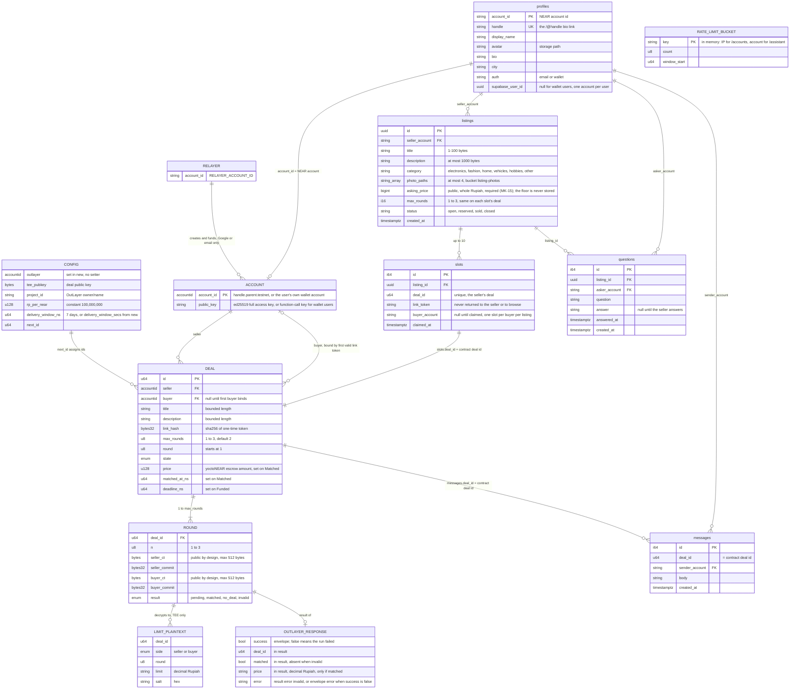

# Data model

Two stores hold data (marketplace pivot, Revision B, 2026-11-12; supersedes "no database" of 2026-11-10, to be recorded in DECISIONS.md). The contract is the source of truth for money, sealed limits and deals, and it is the v1 contract as deployed (`contract/src/lib.rs`, demo `blind-deal-59xtyh4b.testnet`). Supabase holds descriptive data and is reachable only through the relayer. This page maps every piece of data to the one place it lives, so the contract, the TEE, the relayer, Supabase and the app encode the same shapes. Source: docs/superpowers/specs/2026-11-12-marketplace-pivot-design.md.

## Where each piece of data lives

| Store | Persistence | Owner | Holds | Never holds |
|---|---|---|---|---|
| Contract storage (on-chain) | Permanent, public | Ezra | `Config`, `Deal`, per-round ciphertexts and commitments, escrow state | Plaintext limits, salts, the TEE secret, photos |
| Supabase (Postgres, Storage, Auth), relayer-only | Permanent, closed to the anon key | Harfi | `listings`, `slots` (with link tokens), `profiles`, `questions`, `messages`, bucket `listing-photos`, Auth users | Limits, salts, NEAR private keys, copies of deal state |
| TEE (OutLayer WASM) | Memory for one execution | Ezra | Decrypted limits and salts, the `PROTECTED_` secret | Anything after the call returns |
| Relayer (Node) | None, except in-memory rate-limit counters | Harfi | Request and response types (`relayer/src/types.ts`); the Supabase service role key (env) | Deal data, limits, user secret keys, assistant prompts after the call |
| Browser (localStorage, URL) | Per device | Jose | ed25519 keypair (Google or email users) or the wallet's function-call key, the seller's minimum and per-round salts per listing, the buyer's link token and per-round salts | Nothing leaves it except public key, ciphertext and commit |
| `docs/real-deals.md` | Markdown file | Harfi | Anonymised outcome log, if time allows | Names, limits. Not a table, keep it that way |

There is no list-all-deals method. Deals are read by id only; the browse grid comes from Supabase. A `listings` row owns up to 10 `slots`; each slot is one pre-created on-chain deal (`deal_id`) with its link token and, once claimed, the buyer's account. A deal's state is always read from the contract by `deal_id`, never copied. Listing `status` is the one derived mirror (see States).

## ERD

On-chain entities are uppercase. Supabase entities are lowercase.

`ROUND` is the logical view. In storage and in `get_deal` it is the four parallel vectors on `Deal` (`seller_cts`, `buyer_cts`, `seller_commits`, `buyer_commits`), index `n - 1`. `result` is derived from `state` and `round`, not stored. `listings` and `slots` are as in migration 0001; `profiles`, `questions`, `messages` and the `reserved` status come with migration 0002. Column types and keys of the 0002 tables are the builder's call (MK-10). The seller's minimum and salts are not in any table: they stay in the seller's browser, per listing. `RATE_LIMIT_BUCKET` is in-memory maps plus global daily counters, with no persistence. A restart resets them, which is acceptable for a testnet demo.

`LIMIT_PLAINTEXT` is never stored. It exists only inside the TEE for the length of one `match` call. Its commitment is `sha256("blind-deal:v1|{deal_id}|{side}|{round}|{limit}|{salt}")`, the same string on client and TEE (`tee/src/commit.rs`); `tee/testvectors.json` pins examples.

Links between the stores: `slots.deal_id` equals the contract deal id; `messages.deal_id` equals the contract deal id; `profiles.account_id` is the NEAR account (a relayer-created sub-account for Google or email users, the user's own for wallet users). Linking a Google login to a wallet later is Should.

## Access (who reads and writes each table, through which endpoint)

The anon Supabase key reads and writes no table: RLS is on with no policies and grants are revoked from `anon` and `authenticated` (migration 0001 for `listings` and `slots`, 0002 for the rest). The app uses that key for Auth only. Every row below is reached by the relayer with the service role. `claim_slot` is revoked from every role but the service role.

| Table or bucket | Read | Write |
|---|---|---|
| `listings` | Anyone: `GET /listings`, `GET /listings/:id` (open listings only in the grid; `freeSlots` from the `listing_cards` view). Seller: `GET /me/listings` | `POST /listings` (signed), `POST /listings/:id/photos` (seller), `POST /listings/:id/close` (seller); `status` also by `POST /listings/:id/sync` (no auth, derived from chain) |
| `slots` | Browse sees only the free count. Seller: `GET /me/listings` (deal id and buyer, never the token). Buyer: `GET /me/negotiations` (own claimed slots, with the token) | `POST /listings/:id/slots` (seller, verified on chain); claim through `claim_slot` via `POST /listings/:id/claim` (signed buyer) |
| `profiles` | Anyone: `GET /profiles/:handle` (public fields only; `supabase_user_id` never returned) | `POST /accounts` (Supabase JWT) creates; `PUT /me/profile` (signed, own row) |
| `questions` | Anyone: `GET /listings/:id/questions` (answered only). The seller and asker see unanswered ones through `GET /me/inbox` | `POST /listings/:id/questions` (signed); `POST /questions/:id/answer` (the listing's seller only) |
| `messages` | `GET /deals/:dealId/messages` (the deal's seller or buyer, deal Matched or later) | `POST /deals/:dealId/messages` (same rule) |
| Storage `listing-photos` | Public read | Upload through the signed URL from `POST /listings/:id/photos`; JPEG, PNG or WebP, 2 MB each |
| Auth users | Supabase | Supabase Auth; the relayer reads the user from the JWT |

Full-text search covers `listings.title` and `listings.description` (ranking is the builder's call). Each rule needs a test, including one with a third account and one with the anon key.

## States

Contract state table (v1, as built):

| State | Meaning | Entered by | Fields set |
|---|---|---|---|
| Created | Deal exists, no limit yet | Seller `create_deal` | `id`, `link_hash`, `max_rounds`, `round = 1` |
| Waiting | One side has submitted this round | First `submit_limit` of a round | round ciphertext and commit |
| Computing | Both in, OutLayer running | The `submit_limit` that completes the round, with a nonzero fee | second ciphertext and commit |
| Retry | No deal this round, more rounds left | `on_outlayer_result`, `matched: false` or malformed, `round < max_rounds` | `round` incremented |
| NoDeal | Final, no deal | `on_outlayer_result`, `matched: false` or malformed, `round == max_rounds`; seller `cancel` in Created or Waiting; `expire` by anyone 24 h after `matched_at_ns` while unfunded | none |
| Matched | Overlap found | `on_outlayer_result`, `matched: true` | `price`, `matched_at_ns` |
| Funded | Buyer deposited exactly `price`, within 24 h of `matched_at_ns` | Buyer `deposit` | `deadline_ns` (7 days on by default, or `delivery_window_secs` from `new`) |
| Released | Seller paid | Buyer `confirm_received` | none |
| Refunded | Buyer paid back | `refund` by anyone after `deadline_ns` | none |

Final states are NoDeal, Released and Refunded. There are no separate Cancelled or Expired states: a cancelled or expired deal reads as NoDeal. The app tells them apart from the fields: expired has `matched_at_ns` set; cancelled has fewer than `round` ciphertexts on at least one side; otherwise the ranges did not overlap. A malformed or failed OutLayer result counts as a no-deal for that round and follows the Retry or NoDeal rule. A deal stays in Computing only if the callback itself fails, which has no escape yet (DECISIONS.md, contract hardening).

Slot flow on these states: the seller creates a deal and submits round 1, so the slot starts `Waiting`. The buyer's claim hands out the slot; the buyer's `submit_limit` completes round 1 and starts Computing. In a later round the seller must submit again (the contract takes one submission per side per round), so after a no-deal the slot sits in `Retry` until the seller's inbox item "Round 2 requested" is answered.

**Listing status (`listings.status`).** Values `open | reserved | sold | closed`. Only the relayer sets it, on `POST /listings/:id/sync` (and `close`). The app calls sync after every chain call that changes a slot. There is no indexer.

| Condition on the listing's slot deals | Status after sync |
|---|---|
| Row inserted, slots registered, none Matched or Funded | open |
| Any slot deal Matched or Funded | reserved |
| Any slot deal Released | sold |
| The reserving deal ended: NoDeal with `matched_at_ns` set (expired), or Refunded | open |
| Seller calls `POST /listings/:id/close` while open | closed |

Claims are refused unless the listing is `open`. On reservation the seller's app cancels unclaimed and still-Waiting slots (`cancel` allows Created and Waiting). A second buyer whose deal also matched in that window sees "Another buyer got there first" and no pay button; that match expires unfunded after 24 h. Slots are not refilled automatically: "Offers full" means every slot is claimed, and the seller can register more, up to 10 per listing. The deal that holds the reservation is kept in `listings.reserved_deal_id` (never exposed by the API), so a second matching deal does not take over; when that deal is Refunded, or NoDeal with `matched_at_ns` set (an expired match), the listing reopens.

## Units

Users enter Rupiah. The TEE sees and returns Rupiah as integer strings. The contract converts once, at Matched, as Rupiah times `1e24 / rp_per_near`, and stores only the yoctoNEAR `price`. The app shows Rupiah as `price / 1e16`. `deposit` must attach exactly `price`.

Example at the rate of 100,000,000: Rp 4,200,000 becomes 0.042 testnet NEAR, so `price` is 42,000,000,000,000,000,000,000.

## Who builds from this

| Task | Owner | Uses |
|---|---|---|
| Contract and TEE (done, M1-01 to M1-07, unchanged) | Ezra | `Config`, `Deal`, `State`, units |
| MK-04 client crypto, `nearClient` and slot helper (`app/src/`) | Ezra | `Deal`, `State`, v1 commitments, OutLayer shapes, `SlotInput`, `ClaimRes` |
| MK-06 wallet login (NEAR Connect, function-call key) | Ezra | `ACCOUNT` keys, signed-request format, `profiles.auth` |
| MK-05 assistant (`POST /assistant`, prompt) | Ezra | `listings`, answered `questions`, the "unknown" marker |
| MK-07 marketplace round trip (`scripts/roundtrip.mjs`, seed) | Ezra | `listings`, `slots`, both state tables |
| MK-10 migrations 0001 + 0002 (`supabase/migrations/`) | Harfi | `listings` (with `reserved`), `slots`, `profiles`, `questions`, `messages`, access table, anon grants revoked |
| MK-11 `POST /accounts` with Supabase JWT | Harfi | `ACCOUNT`, `profiles`, error codes 401, 409, 429, 503 |
| MK-12 profiles, questions, messages, inbox endpoints and the `reserved` sync | Harfi | `profiles`, `questions`, `messages`, listing status table, `relayer/src/types.ts` |
| MK-20 Google or email sign-in | Harfi | Supabase Auth, `POST /accounts`, `profiles.supabase_user_id` |
| MK-21..MK-25 screens and offer flow | Jose | Both state tables, listing status, `Listing`, `SellerListing`, `Negotiation`, in-memory mocks keyed by `listing_id` and `deal_id` with the same state machine |
