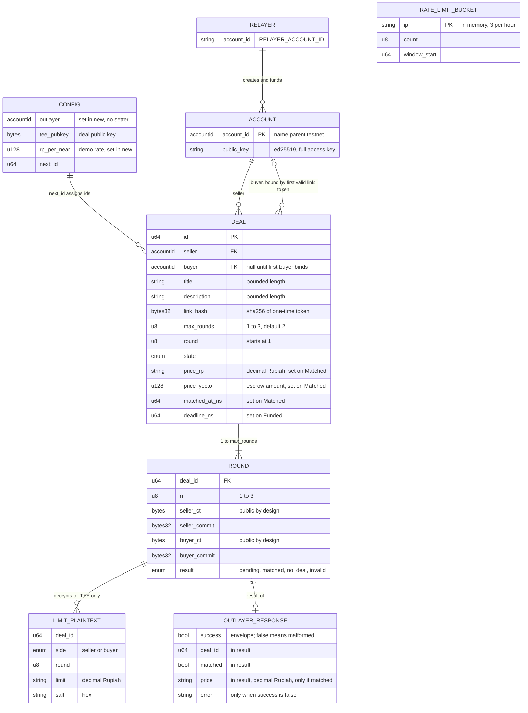

# Data model

There is no database (DECISIONS.md, 2026-11-10). The contract is the source of truth. This page maps every piece of data to the one place it lives, so the contract, the TEE, the relayer and the app encode the same shapes. Field names follow ARCHITECTURE.md; where this page differs, the difference is listed under "Changes proposed" and needs Ezra's approval before it lands in the contract.

## Where each piece of data lives

| Store | Persistence | Owner | Holds | Never holds |
|---|---|---|---|---|
| Contract storage (on-chain) | Permanent, public | Ezra | `Config`, `Deal`, per-round ciphertexts and commitments, escrow state | Plaintext limits, salts, the TEE secret |
| TEE (OutLayer WASM) | Memory for one execution | Ezra | Decrypted limits and salts, the `PROTECTED_` secret | Anything after the call returns |
| Relayer (Node) | None, except in-memory rate-limit counters | Harfi | Request and response types for `POST /accounts` | Deal data, limits, secret keys, NEAR AI prompts |
| Browser (localStorage, URL) | Per device | Jose | ed25519 keypair, per-round salts, the buyer link token | Nothing leaves it except public key, ciphertext and commit |
| `docs/real-deals.md` | Markdown file | Harfi | Anonymised outcome log (S-08) | Names, limits. Not a table, keep it that way |

There is no list-all-deals method. Deals are read by id only, so a "my deals" view is a non-goal. If one is wanted later, it is an optional read-only indexer over contract events, recorded in DECISIONS.md first. Item photos are a PRD "Could", so `Deal` has no media fields.

## ERD

`ROUND` is the logical view. In storage it stays as the four parallel vectors on `Deal` (`seller_cts`, `buyer_cts`, `seller_commits`, `buyer_commits`), which are cheaper in near-sdk. `get_deal` should return the rounds in this shape. `result` is derived from `state` and `round`, not stored. `RATE_LIMIT_BUCKET` is one in-memory map plus one global daily counter, with no persistence. A restart resets it, which is acceptable for a testnet demo.

`LIMIT_PLAINTEXT` is never stored. It exists only inside the TEE for the length of one `match` call. Its commitment is `sha256(limit, salt)` over the same bytes on client and TEE. The exact byte layout is pinned by `tee/testvectors.json` (D1-05), not here.

## States

| State | Meaning | Entered by | Fields set |
|---|---|---|---|
| Created | Deal exists, no limit yet | Seller `create_deal` | `id`, `link_hash`, `max_rounds`, `round = 1` |
| Waiting | One side has submitted this round | First `submit_limit` of a round | round ciphertext and commit |
| Computing | Both in, OutLayer running | Second `submit_limit` | second ciphertext and commit |
| Retry | No deal this round, more rounds left | `on_outlayer_result`, `matched: false` or malformed, `round < max_rounds` | `round` incremented |
| NoDeal | Final, no overlap | `on_outlayer_result`, `matched: false` or malformed, `round == max_rounds` | none |
| Matched | Overlap found | `on_outlayer_result`, `matched: true` | `price_rp`, `price_yocto`, `matched_at_ns` |
| Funded | Buyer deposited exactly `price_yocto` | Buyer `deposit` | `deadline_ns` |
| Released | Seller paid | Buyer `confirm_received` | none |
| Refunded | Buyer paid back | `refund` by anyone after `deadline_ns` | none |
| Cancelled | Seller withdrew before a buyer bound | Seller `cancel` in Created or Waiting with no buyer | none |
| Expired | Matched but never funded | `expire` by anyone, 24 h after `matched_at_ns` | none |

Final states are NoDeal, Released, Refunded, Cancelled and Expired. A malformed or missing OutLayer result never leaves a deal in Computing. It counts as a no-deal for that round and follows the Retry or NoDeal rule.

## Units

Users enter Rupiah. The TEE sees and returns Rupiah as integer strings. The contract converts once, at Matched, using `rp_per_near`, and stores both amounts. `deposit` must attach exactly `price_yocto`.

Example with the default rate of 100,000,000: Rp 4,200,000 becomes 0.042 testnet NEAR, so `price_yocto` is 42,000,000,000,000,000,000,000.

## Changes proposed

These resolve places where the docs disagree. Items 1 to 4 touch shared interfaces #1 and #4, so Ezra must approve them. Items 5 to 8 only align the plan with ARCHITECTURE.md and the build findings.

1. **`SellerIn` is dropped.** The `cancel` row and some test names use it, the enum uses `Waiting`. Keep `Waiting`, and allow `cancel` in Created or Waiting while `buyer` is empty.
2. **Add `Cancelled` and `Expired` to `State`.** `cancel` and `expire` had no target state. Neither holds funds, so neither refunds anything.
3. **Split `price` into `price_rp` and `price_yocto`.** The old field was commented as yoctoNEAR while the TEE returns Rupiah.
4. **`rp_per_near` joins the storage keys and the `new` signature.** It was described in Units but missing from both. Default 100,000,000, the ARCHITECTURE.md value. IMPLEMENTATION.md says 10,000,000 and is corrected.
5. **D1-04 `create_deal` gets `max_rounds`,** matching the ARCHITECTURE.md method table.
6. **The IMPLEMENTATION.md plaintext gains `round`,** matching ARCHITECTURE.md. The monotonic-concession check needs it.
7. **Malformed OutLayer result is stated once, here:** a no-deal for that round, never stuck in Computing. The callback reads the envelope `{"success":true,"result":{"deal_id","matched","price"}}` (DECISIONS.md, OutLayer spike); `success: false`, a missing result or a `deal_id` mismatch counts as malformed.
8. **D1-04 done-check runs on wasm:** `cargo check -p contract --target wasm32-unknown-unknown`, because near-sdk refuses a host build (DECISIONS.md, scaffold pins). Ezra's call.

## Who builds from this

| Task | Owner | Uses |
|---|---|---|
| D1-04 contract stub | Ezra | `Config`, `Deal`, `State`, units |
| D1-05 `app/src/contract.ts` | Ezra | `Deal`, `Round`, `State`, OutLayer shapes |
| D1-06 `relayer/src/types.ts` | Harfi | `ACCOUNT` fields, error codes 409, 429, 503 |
| D1-10 `mockClient.ts` | Jose | In-memory `Deal` map keyed by `id`, same state machine |
