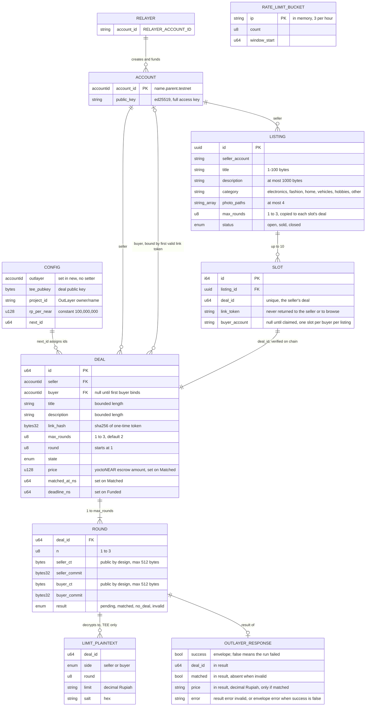

# Data model

Deals, limits and money live only on the contract; marketplace listings live in Supabase (DECISIONS.md, 2026-11-12, which reverses the 2026-11-10 "no database" call). This page maps every piece of data to the one place it lives, so the contract, the TEE, the relayer and the app encode the same shapes. It describes the contract as built (`contract/src/lib.rs`, deployed at M1-07); field names match the code.

## Where each piece of data lives

| Store | Persistence | Owner | Holds | Never holds |
|---|---|---|---|---|
| Contract storage (on-chain) | Permanent, public | Ezra | `Config`, `Deal`, per-round ciphertexts and commitments, escrow state | Plaintext limits, salts, the TEE secret |
| TEE (OutLayer WASM) | Memory for one execution | Ezra | Decrypted limits and salts, the `PROTECTED_` secret | Anything after the call returns |
| Supabase (Postgres + Storage) | Permanent, private (service-role key on the relayer only) | Harfi | `LISTING`, `SLOT`, photos in bucket `listing-photos` | Limits, salts, user keys, copies of deal state |
| Relayer (Node) | None, except in-memory rate-limit counters | Harfi | Request and response types (`relayer/src/types.ts`) | Deal data, limits, secret keys, NEAR AI prompts |
| Browser (localStorage, URL) | Per device | Jose | ed25519 keypair, per-round salts, the buyer link token | Nothing leaves it except public key, ciphertext and commit |
| `docs/real-deals.md` | Markdown file | Harfi | Anonymised outcome log (S-08) | Names, limits. Not a table, keep it that way |

The contract has no list-all-deals method and `Deal` has no media fields. Browsing, search, photos and "my listings / my deals" come from Supabase: a `LISTING` owns up to 10 `SLOT`s, each slot being one pre-created on-chain deal (`deal_id`) with its link token and, once claimed, the buyer's account. A deal's state is always read from the contract by `deal_id`, never copied.

## ERD

`ROUND` is the logical view. In storage and in `get_deal` it is the four parallel vectors on `Deal` (`seller_cts`, `buyer_cts`, `seller_commits`, `buyer_commits`), index `n - 1`. `result` is derived from `state` and `round`, not stored. `RATE_LIMIT_BUCKET` is one in-memory map plus one global daily counter, with no persistence. A restart resets it, which is acceptable for a testnet demo.

`LIMIT_PLAINTEXT` is never stored. It exists only inside the TEE for the length of one `match` call. Its commitment is `sha256("blind-deal:v1|{deal_id}|{side}|{round}|{limit}|{salt}")`, the same string on client and TEE (`tee/src/commit.rs`); `tee/testvectors.json` pins examples.

## States

| State | Meaning | Entered by | Fields set |
|---|---|---|---|
| Created | Deal exists, no limit yet | Seller `create_deal` | `id`, `link_hash`, `max_rounds`, `round = 1` |
| Waiting | One side has submitted this round | First `submit_limit` of a round | round ciphertext and commit |
| Computing | Both in, OutLayer running | The `submit_limit` that completes the round, with a nonzero fee | second ciphertext and commit |
| Retry | No deal this round, more rounds left | `on_outlayer_result`, `matched: false` or malformed, `round < max_rounds` | `round` incremented |
| NoDeal | Final, no deal | `on_outlayer_result`, `matched: false` or malformed, `round == max_rounds`; seller `cancel` in Created or Waiting; `expire` by anyone 24 h after `matched_at_ns` while unfunded | none |
| Matched | Overlap found | `on_outlayer_result`, `matched: true` | `price`, `matched_at_ns` |
| Funded | Buyer deposited exactly `price` | Buyer `deposit` | `deadline_ns` (7 days on) |
| Released | Seller paid | Buyer `confirm_received` | none |
| Refunded | Buyer paid back | `refund` by anyone after `deadline_ns` | none |

Final states are NoDeal, Released and Refunded. There are no separate Cancelled or Expired states: a cancelled or expired deal reads as NoDeal. The app tells them apart from the fields: expired has `matched_at_ns` set; cancelled has fewer than `round` ciphertexts on at least one side; otherwise the ranges did not overlap. A malformed or failed OutLayer result counts as a no-deal for that round and follows the Retry or NoDeal rule. A deal stays in Computing only if the callback itself fails, which has no escape yet (DECISIONS.md, contract hardening).

## Units

Users enter Rupiah. The TEE sees and returns Rupiah as integer strings. The contract converts once, at Matched, as Rupiah times `1e24 / rp_per_near`, and stores only the yoctoNEAR `price`. The app shows Rupiah as `price / 1e16`. `deposit` must attach exactly `price`.

Example at the rate of 100,000,000: Rp 4,200,000 becomes 0.042 testnet NEAR, so `price` is 42,000,000,000,000,000,000,000.

## Earlier proposals, settled

The first draft of this page proposed `Cancelled` and `Expired` states, splitting `price` into `price_rp` and `price_yocto`, `rp_per_near` as a `new` argument, and `cancel` only while no buyer is bound. The contract (M1-01 to M1-07) shipped without them and is live on testnet, so this page follows the code. Adopted from the draft: `Waiting` replaces `SellerIn`, `create_deal` takes `max_rounds`, the plaintext carries `round`, and a malformed result is a no-deal for the round.

## Who builds from this

| Task | Owner | Uses |
|---|---|---|
| Contract (done, M1-01 to M1-07) | Ezra | `Config`, `Deal`, `State`, units |
| `app/src/contract.ts` (done, D1-05) | Ezra | `Deal`, `State`, OutLayer shapes |
| D1-06 `relayer/src/types.ts` | Harfi | `ACCOUNT` fields, error codes 409, 429, 503 |
| D1-10 `mockClient.ts` | Jose | In-memory `Deal` map keyed by `id`, same state machine |
