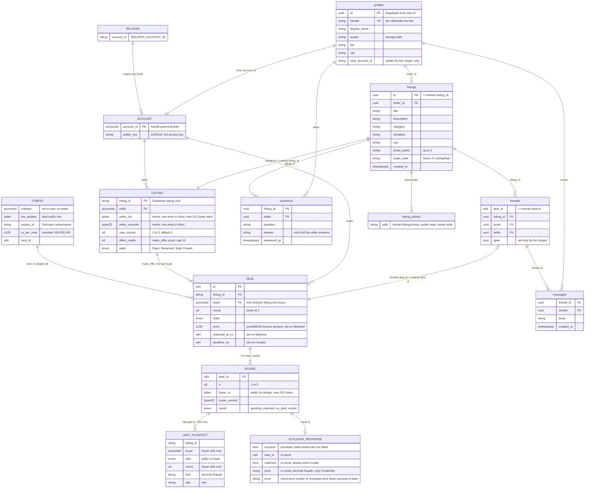

# Data model

Two stores hold data (marketplace pivot, 2026-11-12; supersedes "no database" of 2026-11-10, to be recorded in DECISIONS.md). The contract is the source of truth for money, sealed limits and deals. Supabase holds descriptive data. This page maps every piece of data to the one place it lives, so the contract, the TEE, the relayer, Supabase and the app encode the same shapes. It describes contract v2 (target of MK-01); field names will match the code once it lands. Source: docs/superpowers/specs/2026-11-12-marketplace-pivot-design.md.

## Where each piece of data lives

| Store | Persistence | Owner | Holds | Never holds |
|---|---|---|---|---|
| Contract storage (on-chain) | Permanent, public | Ezra | `Config`, `Listing`, `Deal`, sealed seller limit as ciphertext and commitment, per-round buyer ciphertexts and commitments, escrow state | Plaintext limits, salts, the TEE secret, titles, descriptions, photos |
| Supabase (Postgres, Storage, Auth) | Permanent, private by RLS except public reads | Harfi | `profiles`, `listings` (descriptive fields and `chain_state` mirror), `questions`, `threads`, `messages`, bucket `listing-photos` | Limits, salts, NEAR private keys, anything from which a limit can be derived |
| TEE (OutLayer WASM) | Memory for one execution | Ezra | Decrypted limits and salts, the `PROTECTED_` secret | Anything after the call returns |
| Relayer (Node) | None, except in-memory rate-limit counters | Harfi | Request and response types for its endpoints; the Supabase service role key (env) | Deal data, limits, user secret keys, assistant prompts after the call |
| Browser (localStorage, URL) | Per device | Jose | ed25519 keypair, per-round salts, the seller's salt per listing | Nothing leaves it except public key, ciphertext and commit |
| `docs/real-deals.md` | Markdown file | Harfi | Anonymised outcome log, if time allows | Names, limits. Not a table, keep it that way |

There is no list-all-deals method. Deals are read by id only; the browse grid comes from Supabase, not from the contract. Photos live in Supabase Storage, so `Listing` and `Deal` have no media fields.

## ERD

On-chain entities are uppercase. Supabase entities are lowercase.

`ROUND` is the logical view. In storage and in `get_deal` it is the two parallel vectors on `Deal` (`buyer_cts`, `buyer_commits`), index `n - 1`; the seller's side is the vector on `Listing`. `result` is derived from `state` and `round`, not stored. Row keys for `questions`, `threads` and `messages` (surrogate id or composite), exact column types and the photo-path format are the builder's call (MK-10). The one-Computing-per-listing marker is contract-internal and builder's call. A rate-limit map in the relayer is in memory only (3 per hour per IP plus a global daily counter); a restart resets it, which is acceptable for a testnet demo.

`LIMIT_PLAINTEXT` is never stored. It exists only inside the TEE for the length of one `match` call. Commitments, the same string on client and TEE (`tee/src/commit.rs`; `tee/testvectors.json` pins examples):
- Seller: `sha256("blind-deal:v2|listing|{listing_id}|seller|{limit}|{salt}")`
- Buyer: `sha256("blind-deal:v2|offer|{listing_id}|{buyer}|{round}|{limit}|{salt}")`

Links between the stores: `listings.id` equals the contract `listing_id` (the client picks the uuid before `create_listing`); `threads.deal_id` equals the contract deal id; `profiles.near_account_id` is the NEAR account behind the profile.

## RLS rules (Supabase)

| Table or bucket | Read | Write |
|---|---|---|
| `profiles` | Public | Owner writes own row, except `near_account_id`, which only the relayer (service role) writes |
| `listings` | Public, except rows still in `Draft` (owner only) | Owner inserts and updates own rows; `chain_state` only by the relayer (service role) via sync |
| `questions` | Answered questions public; the asker and the listing's seller also see unanswered ones | Signed-in users insert as themselves; only the listing's seller sets `answer` and `answered_at` |
| `threads` | Buyer and seller of the deal only | `open` set only by the relayer; row creation per `POST /threads/:dealId/open` (builder's call) |
| `messages` | Buyer and seller of the thread only | Same two parties insert as themselves, only when `threads.open` is true |
| Storage `listing-photos` | Public | Owner writes own files |

Full-text search covers `listings.title` and `listings.description` (ranking is the builder's call). Each rule needs a test with a third account.

## States

**Listing**

| State | Meaning | Entered by | Fields set |
|---|---|---|---|
| Open | Accepting blind offers | Seller `create_listing`; `refund` after the deadline; `expire` on an unfunded match | `seller`, `seller_cts`, `seller_commits`, `max_rounds`, `offers_made = 0` (on create) |
| Reserved | A deal matched on it | `on_outlayer_result`, `matched: true` | none |
| Sold | Seller paid | Buyer `confirm_received` | none |
| Closed | Seller withdrew it | Seller `close_listing` while Open | none |

`offers_made` goes up by one on each `make_offer`, so raises do not count. At 10 the app shows "Offers full". At most one deal per listing is in Computing, so a second `make_offer` or `raise_offer` panics "busy" and the app retries.

**Deal**

| State | Meaning | Entered by | Fields set |
|---|---|---|---|
| Computing | OutLayer running for this round | `make_offer` (round 1) or `raise_offer`, with a nonzero fee | `listing_id`, `buyer`, round ciphertext and commit |
| Retry | No deal this round, more rounds left | `on_outlayer_result`, `matched: false` or malformed, `round < max_rounds` | `round` incremented |
| NoDeal | Final, no deal | `on_outlayer_result`, `matched: false` or malformed, `round == max_rounds`; `expire` by anyone after the expiry window from `matched_at_ns` while unfunded | none |
| Matched | Overlap found | `on_outlayer_result`, `matched: true` | `price`, `matched_at_ns` |
| Funded | Buyer deposited exactly `price` | Buyer `deposit` | `deadline_ns` |
| Released | Seller paid | Buyer `confirm_received` | none |
| Refunded | Buyer paid back | `refund` by anyone after `deadline_ns` | none |

Final states are NoDeal, Released and Refunded. Created, Waiting and the seller `cancel` are gone. There is no separate Expired state: an expired deal reads as NoDeal with `matched_at_ns` set. A malformed or failed OutLayer result counts as a no-deal for that round and follows the Retry or NoDeal rule. A deal stays in Computing only if the callback itself fails, which has no escape yet (DECISIONS.md, contract hardening); with the busy rule that also blocks the listing. The expiry window and delivery window values are the builder's call (PR #30).

**Mirror: `listings.chain_state`.** The relayer reads `get_listing` and writes `chain_state` with the service role on `POST /listings/:id/sync`. The app calls it after every chain call that changes the listing. There is no indexer.

| Chain call | `chain_state` after sync |
|---|---|
| (row inserted, `create_listing` not yet confirmed) | Draft (column default; never on-chain) |
| `create_listing` | Open |
| `on_outlayer_result` with a match | Reserved |
| `confirm_received` | Sold |
| `refund`, `expire` | Open |
| `close_listing` | Closed |

An expired reservation shows as Reserved until the next sync. Deal state is not mirrored; the app reads `get_deal` by id. Whether `offers_made` is mirrored too, or the page reads `get_listing`, is the builder's call.

## Units

Users enter Rupiah. The TEE sees and returns Rupiah as integer strings. The contract converts once, at Matched, as Rupiah times `1e24 / rp_per_near`, and stores only the yoctoNEAR `price`. The app shows Rupiah as `price / 1e16`. `deposit` must attach exactly `price`.

Example at the rate of 100,000,000: Rp 4,200,000 becomes 0.042 testnet NEAR, so `price` is 42,000,000,000,000,000,000,000.

## Replaced by v2

Gone from v1: `Created` and `Waiting` states, `link_hash` and the one-time link token, `title` and `description` on-chain, `cancel`, the deal-id binding in commitments (`blind-deal:v1`), and the seller-lowers check in the TEE (the seller's limit is sealed once). Kept: units, the `Retry` and `NoDeal` rules, `Matched`/`Funded`/`Released`/`Refunded`, ciphertext cap, OutLayer fee rule. The v2 contract deploys to a new account; v1 deals are not migrated.

## Who builds from this

| Task | Owner | Uses |
|---|---|---|
| MK-01 Contract v2 | Ezra | `Config`, `Listing`, `Deal`, `ListingState`, `State`, units |
| MK-02 TEE v2 | Ezra | `LIMIT_PLAINTEXT`, v2 commitments, OutLayer shapes in ARCHITECTURE.md |
| MK-04 TS types v2 (`app/src/contract.ts`) | Ezra | `Listing`, `Deal`, both state enums, OutLayer shapes |
| MK-10 Supabase schema (`supabase/migrations/`) | Harfi | `profiles`, `listings`, `questions`, `threads`, `messages`, bucket, RLS table, full-text search |
| MK-11 / MK-12 Relayer endpoints (`relayer/src/types.ts` and handlers; split in IMPLEMENTATION.md) | Harfi | `POST /accounts` with JWT, `/listings/:id/sync`, `/threads/:dealId/open`, `/assistant` (prompt by Ezra), error codes 401, 409, 429, 503 |
| MK-20 Sign-in and accounts (Harfi); MK-21..25 screens and offer flow (Jose); mock and real `ContractClient` (Ezra, MK-04 and MK-03) | Harfi, Jose, Ezra | Both state tables, `chain_state` mirror, in-memory `Listing` and `Deal` maps keyed by `listing_id` and `id`, same state machine |
